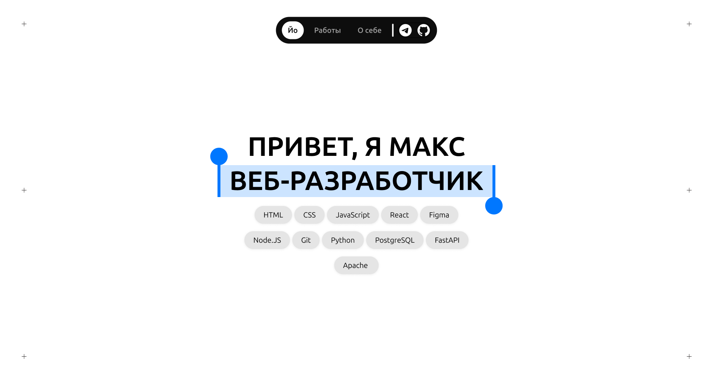

<div align="center">

# MAKSfolio

[](https://im-the-g00se.github.io/MAKSfolio/)
[](https://react.dev/)
[](https://vite.dev/)
[](https://tailwindcss.com/)

</div>



## О проекте

**MAKSfolio** — мой персональный сайт-портфолио, где собраны проекты, опыт и немного информации обо мне. Название появилось из простой формулы: **Maks + portfolio** — идею предложил мой друг и дизайнер сайта. Его работы можно посмотреть в [Telegram-канале](https://t.me/fluedacomp).

В основе проекта — выразительный адаптивный интерфейс с необычной типографикой, карточками работ, каруселью и отдельной страницей «О себе». Для получения информации о проектах также предусмотрен Node.js-сервис, который обращается к GitHub API и собирает данные о проектах из моего репозитория.

## Возможности

- адаптивная вёрстка для мобильных и десктопных устройств;
- страницы с проектами и информацией об авторе;
- интерактивные карточки, карусель и плавные UI-эффекты;
- автоматическая публикация frontend на GitHub Pages;
- получение метаданных и превью проектов через GitHub API;
- единый npm workspace для frontend и backend.

## Стек

| Часть | Технологии |
| --- | --- |
| Frontend | React 19, React Router, Vite 7, Tailwind CSS 4 |
| Backend | Node.js, Express 5, Octokit, dotenv |
| Инструменты | ESLint, npm workspaces, GitHub Actions |
| Деплой | GitHub Pages |

## Структура проекта

```text
MAKSfolio/
├── frontend/          # интерфейс приложения
│   ├── public/        # статические файлы и превью проектов
│   └── src/           # страницы, компоненты и стили
├── backend/           # API для получения данных из GitHub
├── portfolio_info/    # метаданные и изображения для портфолио
└── package.json       # конфигурация npm workspaces
```

## Локальный запуск

### Требования

- Node.js актуальной LTS-версии;
- npm;
- Git.

Клонируйте репозиторий и установите зависимости:

```bash
git clone https://github.com/im-the-g00se/MAKSfolio.git
cd MAKSfolio
npm install
```

Запуск frontend в режиме разработки:

```bash
npm run dev:frontend
```

После запуска Vite выведет локальный адрес приложения в терминале.

### Запуск backend

Создайте файл `backend/.env`:

```env
TOKEN=your_github_token
GH_USERNAME=your_github_username
```

Затем запустите сервер:

```bash
npm run dev:backend
```

API будет доступен по адресу `http://localhost:3000`:

- `GET /check` — проверка работоспособности сервера;
- `GET /repos` — получение данных о репозиториях пользователя.

> На данный момент backend не размещён публично из-за отсутствия бюджета на хостинг. Локально его можно запустить по инструкции выше.

## Полезные команды

```bash
# сборка frontend для production
npm run build --workspace frontend

# проверка frontend с помощью ESLint
npm run lint --workspace frontend

# локальный просмотр production-сборки
npm run preview --workspace frontend
```

## Автор

**Макс** (это я) — frontend-разработчик и автор проекта.

- [GitHub](https://github.com/im-the-g00se)
- [Telegram](https://t.me/the_g00se)

Дизайн: [@fluedacomp](https://t.me/fluedacomp).

---

